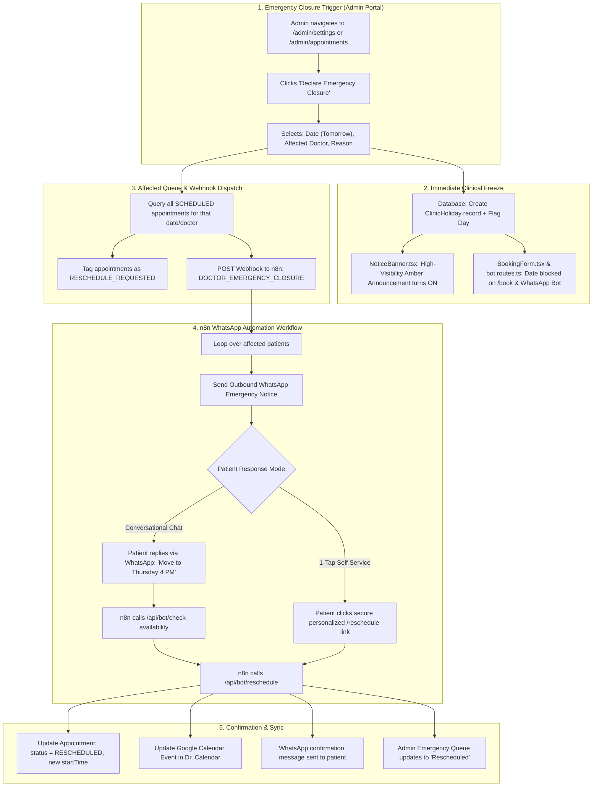

# Architectural Plan: Doctor Emergency Closure & Automated n8n WhatsApp Rescheduling System

## 1. Executive Summary & Codebase Alignment Check

When a doctor experiences an unexpected clinical emergency (e.g., late tonight for tomorrow's shift), the clinic must handle the disruption with zero manual panic:
1. **Instantly block all bookings** for that day across the public website, walk-in desk, and WhatsApp booking bot.
2. **Automatically identify all affected patients** who had appointments scheduled for that day.
3. **Trigger an n8n WhatsApp workflow** to notify each patient immediately and negotiate or assign a new preferred appointment slot.
4. **Reschedule the appointments in the database and Google Calendar** once confirmed.
5. **Provide a real-time Admin Monitoring Queue** so receptionists can see which patients have rescheduled and who needs a manual phone call.

### Codebase & n8n Chatbot Compatibility Verification:
- **Website Availability Engine (`frontend/components/BookingForm.tsx:591-602`)**: **100% Compatible**. The calendar already reads `activeHolidays` from `GET /api/settings/public` and disables matching dates.
- **Bot Availability Checker (`backend/src/routes/bot.routes.ts:135-148`)**: **100% Compatible**. `POST /api/bot/check-availability` already checks active `ClinicHoliday` records and returns `isAvailable: false`.
- **Existing n8n Workflow (`n8n-workflow-updated.json`)**: **100% Compatible**. The current workflow already contains:
  - LangChain AI Agent (`@n8n/n8n-nodes-langchain.agent` with Gemini 3.5 Flash)
  - WhatsApp Business Cloud API node (`phoneNumberId: "831718996699970"`)
  - HTTP Request Tool `Reschedule Appointment` (`PATCH http://host.docker.internal:4000/api/bot/reschedule`)
  - HTTP Request Tool `Check Avaiability` (`POST http://host.docker.internal:4000/api/bot/check-availability`)
  - Bearer Auth (`elite-dental-n8n-bot-secret-key-2026`)
- **Required Backend Hardening**:
  - `PATCH /api/bot/reschedule` currently only checks `isSundayInKarachi`. It **must be updated** to also check `ClinicHoliday` so patients cannot reschedule *into* a closed emergency day.

---

## 2. System Architecture & Information Flow



---

## 3. Detailed Component Breakdown

### Component 1: Admin Emergency Closure Trigger & Freeze

- **UI Location**: 
  - An emergency action button in `/admin/settings` (under Holidays) and in `/admin/appointments`: **"Emergency Closure / Doctor Absence"**.
- **Input Dialog**:
  - **Date**: Pre-filled with tomorrow's date (or date picker).
  - **Doctor**: Dropdown (e.g., "Dr. Sheriyaar", "Dr. Umer", or "Entire Clinic").
  - **Reason**: e.g., *"Urgent Medical / Clinical Emergency"*.
  - **Auto-Website Notice**: Toggle (default: `ON` with `showOnWeb: true`).
- **Backend Execution (`POST /api/settings/emergency-closure`)**:
  1. Inserts a `ClinicHoliday` record for the target date so the banner shows immediately and public availability is 100% blocked.
  2. Queries all appointments where `startTime` falls on that date and `status == 'SCHEDULED'` (filtered by `doctorId` if specific doctor selected).
  3. Prepares an impacted patient roster:
     ```json
     {
       "event": "DOCTOR_EMERGENCY_CLOSURE",
       "date": "2026-11-18",
       "doctorName": "Dr. Sheriyaar",
       "reason": "Emergency doctor unavailability",
       "affectedAppointments": [
         {
           "appointmentId": "uuid-1",
           "patientName": "Fahad Ali",
           "patientPhone": "+923145475528",
           "treatmentName": "Root Canal Consultation",
           "originalTime": "2:00 PM",
           "secureRescheduleToken": "jwt-token-with-appt-id"
         }
       ]
     }
     ```
  4. Dispatches the payload to the configured `N8N_EMERGENCY_WEBHOOK_URL` (with fallback to `localhost:5678` or `host.docker.internal:5678`).

---

### Component 2: Website & Bot Booking Slot Disabling

- **Website DatePicker (`frontend/components/BookingForm.tsx`)**:
  - The date is automatically disabled because `GET /api/settings/public` returns the new emergency closure in `activeHolidays`.
  - Patients cannot click or select that date.
- **Time Slot Selector (`frontend/components/ui/time-slot-selector.tsx`)**:
  - If a user somehow lands on that date, `GET /api/appointments/availability` returns:
    ```json
    { "slots": [], "dayOff": true, "reason": "Clinic is closed due to Doctor Emergency Absence." }
    ```
- **WhatsApp Booking Bot (`backend/src/routes/bot.routes.ts`)**:
  - `POST /api/bot/check-availability` checks active `ClinicHoliday` and rejects that date with a polite notice:
    *"Dr. [Doctor] is unavailable on [Date] due to an emergency. The next available day is [Next Date]."*
- **Hardening Reschedule Endpoint**:
  - In `backend/src/routes/bot.routes.ts`, add `clinicHoliday` validation to `PATCH /api/bot/reschedule` so attempts to reschedule into the closed date are blocked.

---

### Component 3: n8n WhatsApp Workflow Architecture

The n8n workflow integrates with `n8n-workflow-updated.json`:

#### Sub-flow A: Outbound Emergency Blast (Webhook Trigger)
1. **Webhook Node**: Receives `DOCTOR_EMERGENCY_CLOSURE` from backend at path `/webhook/emergency-closure`.
2. **Split In Batches Node**: Iterates through each affected appointment in `affectedAppointments`.
3. **WhatsApp Message Node** (`n8n-nodes-base.whatsApp` using existing credentials): Dispatches the emergency template:
   > *"Assalam-o-Alaikum **{{patientName}}**,*  
   > *Due to an unavoidable clinical emergency with **{{doctorName}}**, Elite Dental Centre will be closed tomorrow, **{{date}}**.*  
   >  
   > *We sincerely apologize for this inconvenience. Your **{{treatmentName}}** appointment needs to be rescheduled.*  
   >  
   > *👉 **How would you like to reschedule?***  
   > *1. Reply directly to this message with your preferred day (e.g., 'Thursday at 4 PM' or 'Friday morning').*  
   > *2. Or tap this link to pick any open slot in 10 seconds: {{rescheduleLink}}*  
   >  
   > *Our team is ready to assist you right now."*

#### Sub-flow B: Conversational Reschedule AI (Inbound WhatsApp Trigger)
1. **Inbound WhatsApp Message Trigger** (`WhatsApp Trigger` in `n8n-workflow-updated.json`): Matches replies from impacted patients.
2. **Context & Availability Check**:
   - AI Agent invokes existing tool `Check Avaiability` (`POST http://host.docker.internal:4000/api/bot/check-availability`).
   - If available, suggests: *"We have 2:30 PM, 4:00 PM, and 5:30 PM open on Thursday. Which one works best for you?"*
3. **Reschedule Execution**:
   - AI Agent invokes existing tool `Reschedule Appointment` (`PATCH http://host.docker.internal:4000/api/bot/reschedule`).
4. **Confirmation Dispatch**:
   - WhatsApp Bot confirms: *"All set, {{patientName}}! Your appointment has been rescheduled to Thursday, Nov 19 at 4:00 PM with {{doctorName}}. See you then!"*

---

### Component 4: Frictionless 1-Tap Web Reschedule Portal

For patients who prefer viewing a calendar on their phone rather than chatting back and forth:
- **URL**: `https://elitedental.com/reschedule?token=xyz`
- **Behavior**:
  - Decrypts the secure JWT token, verifies `appointmentId`.
  - Pre-loads: Patient name, procedure, doctor, and current appointment details.
  - Highlights open dates (with the emergency date blocked).
  - Once the patient selects a slot, clicking **"Confirm Reschedule"** executes the reschedule without requiring passwords or re-entering phone numbers.

---

### Component 5: Admin Emergency Monitoring Queue

In `frontend/app/admin/appointments/page.tsx`, when an emergency closure is active for a date:
- Displays a dedicated **Emergency Reschedule Roster**:
  | Patient | Treatment | Original Slot | Reschedule Status | Action |
  | :--- | :--- | :--- | :--- | :--- |
  | Fahad Ali | Root Canal | Tomorrow 2:00 PM | 🟢 **Rescheduled** (Thu 4:00 PM) | View Record |
  | Arman | Implant Kit | Tomorrow 3:30 PM | 🟡 **Message Sent (No Reply Yet)** | Direct Call / WhatsApp |
  | Wajiha | Braces Adj. | Tomorrow 5:00 PM | 🔵 **Link Opened** | Call Patient |
- Receptionists can instantly see who needs a direct phone follow-up.

---

## 4. Implementation Stages

| Stage | Focus Area | Deliverables |
| :--- | :--- | :--- |
| **Stage 1** | **Backend Emergency API** | `POST /api/settings/emergency-closure`: Date blocking, appointment query, status tagging, webhook dispatch. |
| **Stage 2** | **Slot & Bot Guarding** | Update `PATCH /api/bot/reschedule` in `bot.routes.ts` with `clinicHoliday` checks. |
| **Stage 3** | **n8n Workflow Integration** | Add Webhook trigger & dispatch flow to `n8n-workflow-updated.json`. |
| **Stage 4** | **1-Tap Reschedule Web Portal** | `/reschedule` client page with token validation and one-click calendar selection. |
| **Stage 5** | **Admin Dashboard Queue** | Emergency trigger dialog in `/admin/settings` + live reschedule tracking tab in `/admin/appointments`. |

---

## 5. Verification & Testing Protocol

1. **Simulated Emergency Trigger**:
   - Create 2 test appointments for tomorrow (Nov 18).
   - Trigger Emergency Closure for Nov 18 from Admin.
2. **Website Slot Verification**:
   - Check `/book` and verify Nov 18 is disabled in the datepicker.
   - Query `/api/bot/check-availability` for Nov 18 and verify `available: false`.
3. **Webhook & Reschedule Execution**:
   - Verify webhook receives appointment payload.
   - Execute `PATCH /api/bot/reschedule` to Nov 19.
   - Verify DB status updates to `RESCHEDULED` and Google Calendar event shifts to Nov 19.
4. **Admin Queue Verification**:
   - Verify admin queue reflects `Rescheduled to Nov 19` in real-time.

