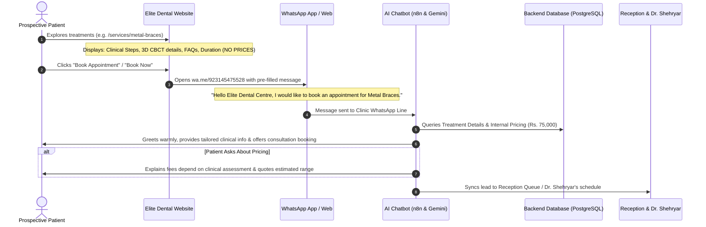
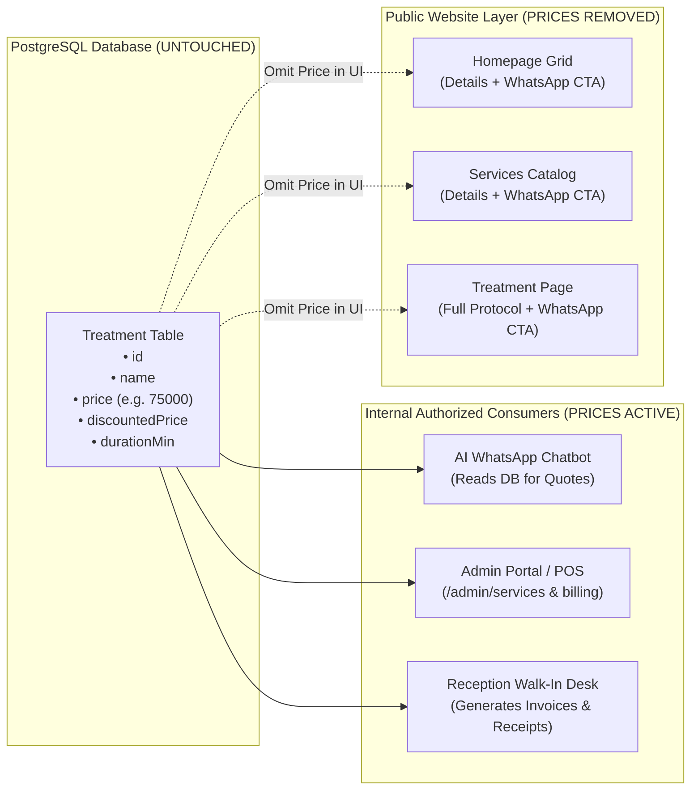

# Architectural Plan: Public Treatment Price Removal & Contextual WhatsApp Chatbot Booking Engine

## 1. Executive Summary & Clinical Rationale

Elite Dental Centre operates as a premier clinical dental practice in Islamabad under the clinical leadership of **Dr. Shehryar Akhtar** (Dental Surgeon & Orthodontist). 

### The Problem with Static Public Pricing
In modern specialized dentistry (Orthodontics, Clear Aligners, Guided Implants, Cosmetic Smile Makeovers, and Multi-Canal Root Canals), rigid public pricing displays create friction and patient hesitation:
1. **Clinical Variance**: Every patient's oral anatomy is unique. An implant or orthodontic plan cannot be accurately quoted without panoramic radiographs, 3D CBCT scans, bone density assessments, and bracket/material selection.
2. **Older Clinic Website Parity (`elitedentalcentrepk.com/treatments.php`)**: The clinic's original website showcases deep clinical descriptions, procedures, indications, and benefits **without displaying fixed prices**, directing patients to clinical inquiry.
3. **High-Conversion WhatsApp Handoff**: Rather than abandoning patients in a cold web form, every treatment session and procedure should provide an immediate **"Book Now" / "Book Appointment"** button that redirects the patient directly to the clinic's WhatsApp line (`+92 314 5475528`) with pre-filled clinical context.

### Core Architecture Principles
- **Public Website (`frontend/`)**: 100% price-free. All treatment cards, service detail pages, and booking selectors present comprehensive clinical procedures, duration, doctor notes, and FAQs without showing any numeric `Rs.` or PKR fees.
- **Contextual WhatsApp Routing**: Every "Book Now" or "Book Appointment" button instantly directs the patient to `https://wa.me/923145475528?text=...` with an intelligent, URL-encoded greeting specifying the requested procedure.
- **Backend & AI Agent Data Integrity (Protected)**: **Zero changes** to backend pricing tables or API endpoints. The PostgreSQL `Treatment` table (`price`, `discountedPrice`, `category`, `durationMin`), Prisma schema, `/api/treatments`, and n8n webhook routes remain completely intact so the AI chatbot and clinic reception desk have instant access to exact costs, installment schedules, and billing rates.

---

## 2. System Architecture & Interaction Flow



---

## 3. WhatsApp Pre-filled Payload Specification

All WhatsApp redirects route through a centralized utility (`frontend/lib/whatsapp.ts`) to maintain consistent phone number formatting, country codes, and URL encoding.

### Clinic WhatsApp Number
- International Standard: `+92 314 5475528`
- WhatsApp URL Format: `923145475528` (digits only, no `+` or spaces)

### Contextual Payloads Matrix

| Source Location | Button Label | Pre-Filled Message Format | Encoded Link Output |
|---|---|---|---|
| **Global Navbar** | Book Visit | *"Hello Elite Dental Centre, I would like to book a dental appointment with Dr. Shehryar Akhtar."* | `https://wa.me/923145475528?text=Hello%20Elite...` |
| **Homepage Treatment Card** | Book on WhatsApp | *"Hello Elite Dental Centre, I would like to book an appointment for [Treatment Name]."* | `https://wa.me/923145475528?text=...` |
| **Service Catalog Card** | Book Now | *"Hello Elite Dental Centre, I would like to book an appointment for [Treatment Name]."* | `https://wa.me/923145475528?text=...` |
| **Service Detail Page (Hero)** | Book Appointment | *"Hello Elite Dental Centre, I would like to book an appointment for [Treatment Name]."* | `https://wa.me/923145475528?text=...` |
| **Service Detail (Doctor Q&A)** | Ask Doctor on WhatsApp | *"Hello Doctor, I have questions regarding [Treatment Name]. Could you please advise?"* | `https://wa.me/923145475528?text=...` |
| **Symptom Matcher** | Book Recommended Care | *"Hello Elite Dental Centre, I am experiencing [Symptom] and would like to consult Dr. Shehryar Akhtar for [Treatment Name]."* | `https://wa.me/923145475528?text=...` |

---

## 4. Backend Database & AI Chatbot Safety Guarantee

> [!IMPORTANT]
> **Strict Non-Destructive Policy**: Prices are solely removed from the visual presentation layer (`JSX` rendering). Backend schemas, database records, and server APIs remain 100% untouched.



---

## 5. Detailed Component & Page Implementation Plan

### Task 1: Centralized WhatsApp Link Generator
- **Target File**: `frontend/lib/whatsapp.ts`
- **Functionality**:
  ```typescript
  export const CLINIC_WHATSAPP_NUMBER = "923145475528";

  export function getWhatsAppBookingUrl(treatmentName?: string, customNote?: string): string {
    let message = "Hello Elite Dental Centre, I would like to book a dental appointment with Dr. Shehryar Akhtar.";
    if (treatmentName) {
      message = `Hello Elite Dental Centre, I would like to book an appointment for ${treatmentName}.`;
    }
    if (customNote) {
      message += ` Note: ${customNote}`;
    }
    return `https://wa.me/${CLINIC_WHATSAPP_NUMBER}?text=${encodeURIComponent(message)}`;
  }
  ```

### Task 2: Homepage (`frontend/app/page.tsx`)
- **Action**:
  - In Section 3 (Featured Treatments Matrix), remove the `Standard Fee {formatPKR(t.price)}` block.
  - In its place, render:
    1. A secondary `"View Details"` link pointing to `/services/${t.id}`.
    2. A primary `"Book on WhatsApp"` button with WhatsApp icon calling `getWhatsAppBookingUrl(t.name)`.
  - Update Section 3 subtitle copy from *"Upfront transparent estimates with zero hidden charges"* to *"Personalized treatment plans tailored to your clinical requirements by Dr. Shehryar Akhtar"*.

### Task 3: Services Catalog (`frontend/app/services/ServicesClient.tsx`)
- **Action**:
  - Remove `Fee Range {formatPriceRange(treatment.price, treatment.maxPrice)}` from treatment cards.
  - Replace the card footer with:
    - `"Consultation-Based Estimate"` clinical badge.
    - Direct `"Book Now"` button opening WhatsApp with pre-filled treatment title.
  - In the Symptom & Treatment Matcher section, update the primary action button from opening the modal to redirecting to WhatsApp with the matched treatment context.
  - Retain all category filters, search input, procedure descriptions, and duration badges.

### Task 4: Service Detail Page (`frontend/app/services/[id]/page.tsx`)
- **Action**:
  - Replace the "Estimated Fee Range" box with a modern **"Clinical Consultation & Customized Quote"** card:
    - Highlights: PMDC-certified evaluation, 3D panoramic diagnostics, customized staging plan.
  - Update the primary hero button to `"Book Appointment on WhatsApp"` linking to `getWhatsAppBookingUrl(treatment.name)`.
  - Update the secondary doctor contact link: remove `(PKR ${treatment.price})` from the URL string.
  - Replace the legacy name on line 492 (`Dr. Jalil Riaz`) with `Dr. Shehryar Akhtar`.
  - Replace the bottom `#book-slot` section with an interactive **WhatsApp Booking Concierge Card** featuring direct 1-click redirection, response time badge (*"Replies within 15 minutes during clinic hours"*), and emergency hotline note.

### Task 5: Booking Form Sanitization (`frontend/components/BookingForm.tsx`)
- **Action**:
  - Remove price rendering from dropdown options: `{t.name} ({t.durationMin} mins)` (omit `formatPKR` / `formatPriceRange`).
  - Remove price summary calculations in step 2 of the booking form so if patients access any direct booking link, no prices are shown.

### Task 6: Global Navigation & About CTAs
- **Target Files**: `frontend/components/Navbar.tsx`, `frontend/components/AboutHero.tsx`, `frontend/components/AboutClient.tsx`, `frontend/app/doctors/page.tsx`
- **Action**:
  - Route "Book Visit" and "Book Appointment" buttons to `getWhatsAppBookingUrl()` with appropriate context.

---

## 6. Implementation & Verification Matrix

| Task # | Scope | Target File | Verification Criteria |
|---|---|---|---|
| **1** | Utility | `frontend/lib/whatsapp.ts` | URL outputs valid `wa.me/923145475528?text=...` with proper escaping |
| **2** | Homepage | `frontend/app/page.tsx` | Zero `Rs.` figures in Section 3; WhatsApp CTA functions properly |
| **3** | Catalog | `frontend/app/services/ServicesClient.tsx` | All treatment cards price-free; "Book Now" opens WhatsApp |
| **4** | Detail Page | `frontend/app/services/[id]/page.tsx` | Price box replaced with Consultation card; Dr. Shehryar name fixed |
| **5** | Form Sanitization | `frontend/components/BookingForm.tsx` | Treatment select lists only display name and duration |
| **6** | Global CTAs | `Navbar.tsx`, `AboutHero.tsx`, etc. | All "Book" buttons link seamlessly to WhatsApp |
| **7** | Backend Check | `backend/src/routes/treatments.routes.ts` | `curl localhost:4000/api/treatments` returns intact price attributes |
| **X** | Build & Typecheck | `tsc --noEmit` on frontend & backend | Monorepo compiles cleanly with **0 errors** |
